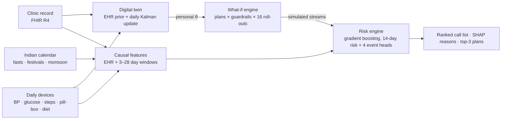

# HridayTwin: a personal digital twin for predicting adverse cardiometabolic events

**Course project · Advanced Machine Learning for Business Transformation (AMLBT)**
**PGDM Big Data Analytics, Goa Institute of Management (2026–28)**

> A living, personal model of each patient with type 2 diabetes and/or hypertension. It fuses the clinic record (EHR) with daily home data from a step counter, a smart pill-box, a glucometer or CGM and a home BP cuff. It learns how *this* patient responds to their medicines, warns the care team before an adverse event, and lets a clinician test a care plan on the twin before trying it on the patient.

| | |
|---|---|
| **Team** | Manjit Kalita · Dhruvik Sorathiya · Kruparth Pandya |
| **Institute** | Goa Institute of Management, Big Data Analytics |
| **Project report (IEEE format)** | [`report/HridayTwin_AMLBT_Report.pdf`](report/HridayTwin_AMLBT_Report.pdf) · LaTeX source in [`report/`](report/) |
| **Clinician console** | [`dashboard/index.html`](dashboard/index.html): one self-contained file, open it in any browser. With GitHub Pages switched on it is also at `https://mazekerr.github.io/hridaytwin-amlbt/dashboard/` |
| **Cleaned dataset** | [`data/processed/model_table.csv.gz`](data/processed/) (23,710 weekly check-ins × 59 features + labels) |

> ⚠️ Research prototype trained and evaluated **only on synthetic patients** generated by this repository. Not a medical device; not for clinical use.

---

## 1. Business problem

India has an estimated **101 million adults with diabetes and 315 million with hypertension** (ICMR-INDIAB, 2023), and the two often come together. Care happens in short OPD visits weeks or months apart; between visits the clinician sees nothing. Remote-monitoring programmes run by hospital chains, digital-health companies, insurers and employers now collect home readings, but a care coordinator with thousands of readings a day cannot tell **who to call this week, why, and what to change**.

HridayTwin turns that stream into a ranked, explained call list and a short list of tested care plans. Business value: fewer avoidable admissions, fewer coordinator minutes per patient, better HbA1c and BP control.

| Adverse event (14-day horizon) | Typical Indian trigger the system can see |
|---|---|
| Severe hypoglycaemia | Sulfonylurea + religious fasting (Ekadashi, Shravan, Navratri) or a missed meal |
| Hyperglycaemic crisis | Missed doses, refill gaps, monsoon fevers |
| Hypertensive emergency | Uncontrolled home BP, festival salt load, non-adherence |
| Acute CV event | High baseline risk plus triggers: infection (resting-HR spike), BP surge |

## 2. Approach



1. **Digital twin (generative).** Two per-patient Bayesian linear state-space models (glucose, systolic BP), updated daily by a Kalman filter. The prior comes from the EHR (HbA1c → eAG, clinic BP, published drug effects of the patient's medicines); the posterior from home data. Coefficients are the patient's personal physiology, with uncertainty.
2. **Risk engine (discriminative).** `HistGradientBoostingClassifier` on 59 fused features (27 EHR + 29 causal stream windows + 3 calendar), predicting any adverse event in the next 14 days plus four event-type heads; SHAP explanations.
3. **What-if engine.** Candidate plans (one medicine change × steps × salt × adherence support), filtered by clinical guardrails (eGFR cut-offs, no duplicate classes), rolled out 90 days on the twin 16 times with common random numbers, and scored by the same risk engine.

Design rule, chosen from evidence: **the twin simulates, the risk engine judges.** Feeding twin-state features into the risk model made it worse (−0.017 AUROC), so they are kept out. Details: [`docs/ARCHITECTURE.md`](docs/ARCHITECTURE.md), [`docs/MODEL_CARD.md`](docs/MODEL_CARD.md).

## 3. Data

No real patient data is used. [`src/hridaytwin/synth.py`](src/hridaytwin/synth.py) generates a mechanistic synthetic cohort whose priors come from published Indian and trial evidence ([`docs/CLINICAL_RATIONALE.md`](docs/CLINICAL_RATIONALE.md)). Events are drawn from a **hidden** physiological state; models see only noisy, gappy device readings.

| | |
|---|---|
| Cohort | 1,200 patients × 180 days (seed 2026) |
| Raw tables | `ehr.csv` (1 row/patient), `daily.csv` (216,000 patient-days), `events.csv` (724 events), `calendar.csv` |
| Cleaned modelling table | 23,710 weekly check-ins, 59 features, 4.5% positive |
| Committed | `data/processed/model_table.csv.gz` (cleaned) and `data/sample/` (2,000 rows of each raw table). The full raw tables regenerate in seconds |

Column definitions: [`docs/DATA_DICTIONARY.md`](docs/DATA_DICTIONARY.md).

## 4. Results (synthetic cohort)

All numbers are written by the pipeline into [`docs/RESULTS.md`](docs/RESULTS.md); none is typed by hand.

| Model (5-fold CV grouped by patient) | AUROC | AUPRC | Brier | ECE |
|---|---:|---:|---:|---:|
| **Fused EHR + home data (GBM)** | **0.726** | **0.111** | **0.0416** | **0.0053** |
| Fused, logistic regression | 0.717 | 0.106 | – | – |
| Fused + twin-state features | 0.709 | 0.106 | 0.0418 | 0.0068 |
| EHR only | 0.708 | 0.096 | 0.0423 | 0.0104 |
| Home devices only | 0.675 | 0.098 | 0.0421 | 0.0072 |
| Threshold rules (no model) | 0.615 | 0.072 | – | – |

- Fused vs EHR-only: **+0.017 AUROC** (95% CI +0.004 to +0.032, patient-level bootstrap p = 0.008); fused wins on **3/3** generator seeds.
- Largest gain for **severe hypoglycaemia**: AUROC 0.943 vs 0.907 (p = 0.002).
- At **10 alerts per 100 patient-weeks**: sensitivity 29%, PPV 13%, 2.9× lift, median warning **7 days** before the event.
- The twin learns the individual: correlation of its drug-response estimate with the hidden truth rises from 0 to **0.64** (glucose) and **0.54** (BP) over 26 weeks; 95% / 97% of readings fall inside its 2-SD band.
- Leakage control: label-permutation AUROC 0.515. Temporal hold-out: 0.686 vs 0.681.

**What did not work:** twin-state features hurt the risk model; the twin does not learn step sensitivity; acute CV events are not improved by home data; within-patient timing is only 0.557. See [`docs/RESULTS.md#4-negative-findings-and-caveats`](docs/RESULTS.md#4-negative-findings-and-caveats).

## 5. Reproduce everything

Tested with Python 3.11 (CI) and 3.13; exact versions in [`requirements-lock.txt`](requirements-lock.txt).

```bash
git clone https://github.com/Mazekerr/hridaytwin-amlbt.git
cd hridaytwin-amlbt
pip install -r requirements.txt     # or: pip install -r requirements-lock.txt
python run_pipeline.py              # full run incl. 3-seed sweep, ~4 min on a laptop CPU
pytest                              # 16 tests
python report/make_figures.py       # figures used in the IEEE report
python report/extra_analyses.py   # alert-budget table + SHAP ranking quoted in the report (about 2 min)
```

Or with `make`: `make install && make all`. A quick smoke run: `python run_pipeline.py --quick` (300 patients × 120 days, ~1 min).

What `run_pipeline.py` does, in order:

| Step | Module | Output |
|---|---|---|
| 1. Generate synthetic cohort | `synth.py` | `data/*.csv` |
| 2. Twin + features + train/evaluate all models | `twin.py`, `features.py`, `model.py` | `model/metrics.json`, `data/processed/model_table.csv.gz` |
| 3. Validate twin vs hidden truth, seed sweep | `validate.py` | `model/twin_validation.json`, `model/seed_robustness.json` |
| 4. Build clinician console | `export_dashboard.py` | `dashboard/index.html` |
| 5. FHIR R4 export | `fhir.py` | `docs/sample_fhir_bundle.json` |
| 6. Results report | `report.py` | `docs/RESULTS.md`, `docs/figures/` |

The pipeline is deterministic: a fresh run reproduces every number in the report exactly. GitHub Actions ([`.github/workflows/ci.yml`](.github/workflows/ci.yml)) runs the tests and a reduced pipeline on every push.

To rebuild the report PDF: `cd report && latexmk -pdf main.tex`, or upload `main.tex` and `figures/` to Overleaf.

## 6. Repository structure

```
hridaytwin-amlbt/
├── run_pipeline.py            # one command: data → twin → models → validation → console → report
├── Makefile                   # make install | run | quick | test | figures | report | all
├── src/hridaytwin/
│   ├── config.py              # every tunable in one place
│   ├── synth.py               # mechanistic synthetic cohort (EHR + daily stream + events)
│   ├── twin.py                # the digital twin: EHR prior + daily Kalman update
│   ├── features.py            # causal fused features + labels
│   ├── model.py               # risk engine: training, ablations, bootstrap, temporal hold-out
│   ├── simulate.py            # what-if engine + clinical guardrails + plan ranking
│   ├── validate.py            # twin vs hidden truth; seed robustness
│   ├── export_dashboard.py    # held-out console data + SHAP + alerts
│   ├── fhir.py                # FHIR R4 export/import (ABDM-ready)
│   └── report.py              # writes docs/RESULTS.md + figures
├── data/
│   ├── processed/             # cleaned modelling table (committed)
│   └── sample/                # 2,000-row sample of each raw table (full data regenerates)
├── model/                     # metrics.json, twin_validation.json, seed_robustness.json
├── dashboard/                 # template.html (source) → index.html (generated, self-contained)
├── report/                    # IEEE report: main.tex, figures/, make_figures.py, PDF
├── notebooks/                 # walkthrough of the cleaned dataset and results
├── docs/                      # RESULTS (generated), ARCHITECTURE, MODEL_CARD, CLINICAL_RATIONALE,
│                              # DATA_DICTIONARY, VALIDATION_PLAN, ETHICS_PRIVACY, IMPACT
├── tests/                     # determinism, leakage, labels, twin, guardrails, FHIR round-trip
└── .github/workflows/ci.yml
```

## 7. Technical stack

Python · NumPy · pandas · scikit-learn (`HistGradientBoostingClassifier`, `LogisticRegression`, `GroupKFold`) · SHAP · matplotlib · custom vectorised Kalman filter · HL7 FHIR R4 · single-file HTML/JS console · pytest · GitHub Actions · LaTeX (IEEEtran).

## 8. Privacy, safety and limitations

- Synthetic data only; designed for India's DPDP Act 2023 and ABDM consent-managed exchange ([`docs/ETHICS_PRIVACY.md`](docs/ETHICS_PRIVACY.md)).
- Decision support only: every plan is labelled *for clinician review*; nothing acts on its own.
- Real-world validation plan: [`docs/VALIDATION_PLAN.md`](docs/VALIDATION_PLAN.md).

## 9. AI use declaration

Claude (Anthropic) was used to draft and copy-edit the project report, write `report/make_figures.py` and `report/extra_analyses.py`, and reorganise this repository's documentation. All results were regenerated by the pipeline and checked by the team. The same declaration appears in Section VII-A of the report.

## License

MIT (code). Synthetic data generated by this code may be used freely. See [`LICENSE`](LICENSE).
